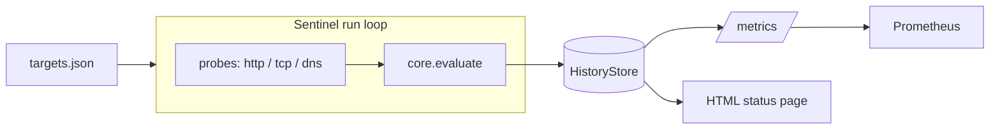

# uptime-sentinel

A small, self-hosted synthetic-monitoring service. It probes a configured list
of targets on a schedule (or on demand), records the results, computes uptime,
exposes Prometheus metrics, and serves a minimal HTML status page.

## Why

Most teams do not need a heavyweight monitoring stack to answer the everyday
question "is this endpoint reachable, and how fast?". `uptime-sentinel` is a
single Python process that checks HTTP status + latency, TCP port reachability,
and DNS resolution, then presents the results in three ways that ops already
consume: a JSON summary, a Prometheus scrape endpoint, and a human-readable
status page.

The design keeps a strict split between **pure logic** and **side effects** so
almost all of the behaviour is unit-testable without a network:

- `sentinel/core.py` is pure: it turns raw probe output into results and
  aggregates uptime. No I/O.
- `sentinel/probes.py` holds the only network-touching code (stdlib
  `urllib`/`socket`), which tests monkeypatch.

## Architecture



## Quickstart

```bash
pip install -r requirements.txt
uvicorn sentinel.server:app --host 0.0.0.0 --port 8000
```

Then, in another shell:

```bash
# Trigger a check pass and see the raw results
curl -X POST http://localhost:8000/run

# Per-target JSON summary (uptime %, last status, avg latency)
curl http://localhost:8000/status

# Prometheus metrics
curl http://localhost:8000/metrics

# Open the status page in a browser
open http://localhost:8000/        # macOS
start http://localhost:8000/       # Windows
```

By default the service loads `examples/targets.json`. Point it elsewhere with
the `SENTINEL_CONFIG` environment variable.

## Configuration format

Targets are defined in a JSON file, either as a top-level array or under a
`"targets"` key. Each target has a `name`, a `kind`, and the fields relevant to
that kind:

| kind   | required fields   | optional               |
| ------ | ----------------- | ---------------------- |
| `http` | `url`             | `expect_status` (200), `timeout` (5) |
| `tcp`  | `host`, `port`    | `timeout` (5)          |
| `dns`  | `hostname`        | `timeout` (5)          |

```json
{
  "targets": [
    { "name": "example-web", "kind": "http", "url": "https://example.com", "expect_status": 200 },
    { "name": "example-https-port", "kind": "tcp", "host": "example.com", "port": 443 },
    { "name": "example-dns", "kind": "dns", "hostname": "example.com" }
  ]
}
```

## HTTP surface

| Method | Path       | Description                                        |
| ------ | ---------- | -------------------------------------------------- |
| GET    | `/health`  | Liveness probe (used by the Docker HEALTHCHECK).   |
| GET    | `/metrics` | Prometheus text exposition.                        |
| POST   | `/run`     | Trigger one check pass; returns the batch of results. |
| GET    | `/status`  | JSON per-target summary.                           |
| GET    | `/`        | Minimal HTML status page (green/red per target).   |

## Metrics

| Metric                             | Type      | Labels             | Meaning                              |
| ---------------------------------- | --------- | ------------------ | ------------------------------------ |
| `sentinel_up`                      | Gauge     | `target`           | 1 if up at the last check, else 0.   |
| `sentinel_check_duration_seconds`  | Histogram | `target`           | Check latency in seconds.            |
| `sentinel_checks_total`            | Counter   | `target`, `outcome`| Count of checks by `up`/`down`.      |

## Docker

```bash
docker build -t uptime-sentinel .
docker run -p 8000:8000 uptime-sentinel
```

The image runs as a non-root user and ships a HEALTHCHECK that hits `/health`.
Mount your own config over the default:

```bash
docker run -p 8000:8000 \
  -e SENTINEL_CONFIG=/config/targets.json \
  -v "$PWD/my-targets.json:/config/targets.json:ro" \
  uptime-sentinel
```

## Testing

```bash
pip install -r requirements.txt pytest httpx
pytest -q
```

The suite runs fully offline: the three network probes are monkeypatched to
canned responses, and the FastAPI endpoints are exercised with
`fastapi.testclient.TestClient`.

## Project structure

```
uptime-sentinel/
├── sentinel/
│   ├── __init__.py      # version + package docstring
│   ├── models.py        # pydantic Target / CheckResult
│   ├── probes.py        # live http/tcp/dns probes (stdlib only)
│   ├── core.py          # pure: evaluate, uptime_pct, summarize
│   ├── config.py        # load_targets() with clear validation errors
│   ├── store.py         # bounded in-memory history
│   ├── metrics.py       # Prometheus gauge / histogram / counter
│   ├── service.py       # Sentinel: config + probes + store + metrics
│   └── server.py        # FastAPI app + HTML status page
├── examples/targets.json
├── tests/
│   ├── test_core.py
│   ├── test_config.py
│   └── test_service_api.py
├── Dockerfile
├── pyproject.toml
├── requirements.txt
└── README.md
```
